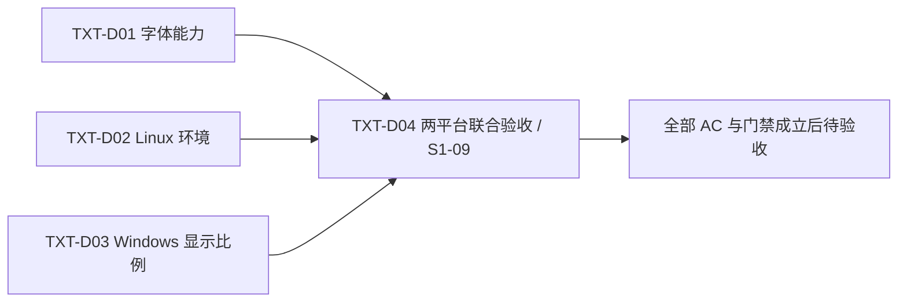
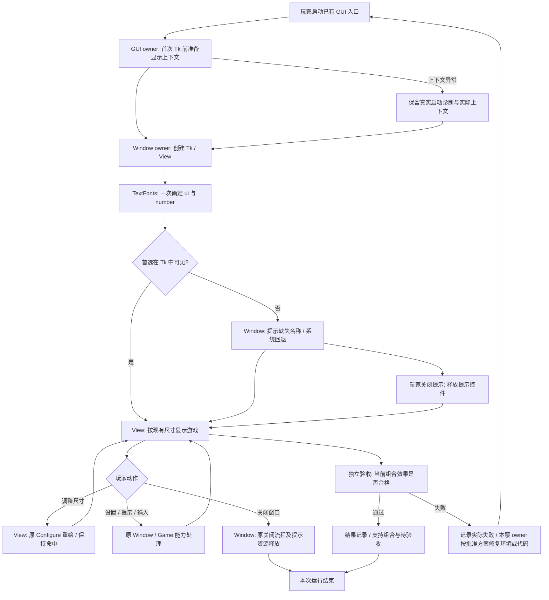
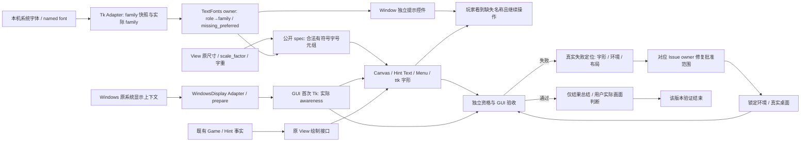
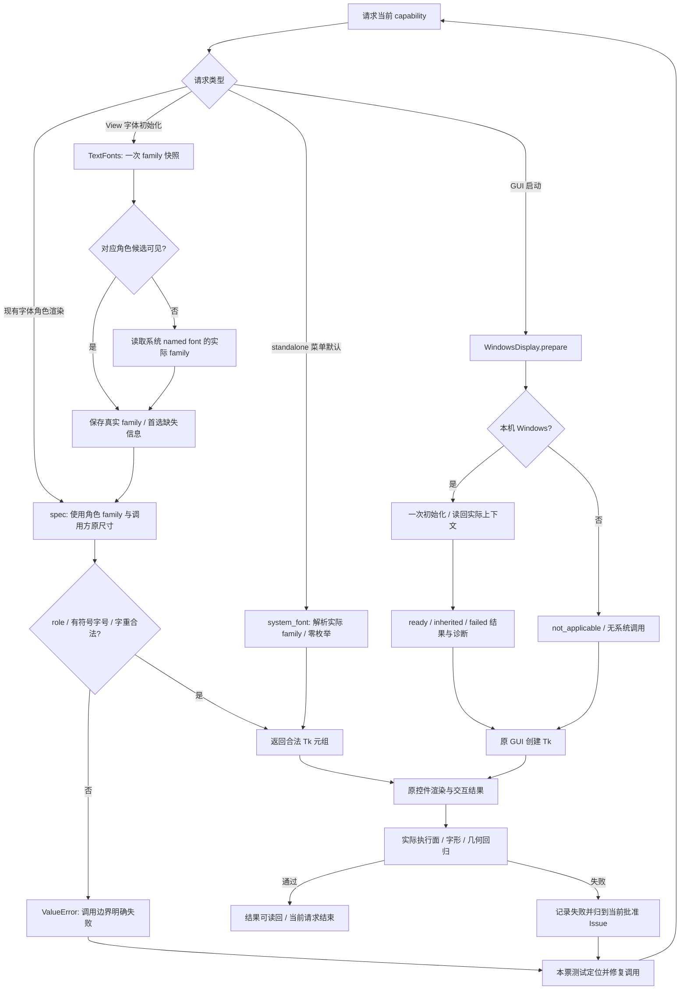

# 界面文字联合方案决策草案

日期：2026-10-12。来源：S1-09「界面文字缩放锯齿与乱码」。状态：完整推荐路线草案，待用户通过 productivity:grilling 裁决 Q1～Q3 并批准。执行方式：solution-decision 语义执行；本次产物为草案，不登记正式 Issue、不发布 canonical 方案、不修改运行代码和现行 ADR。

## 1. 问题、结果与已确认约束

用户希望 Linux 和 Windows 上的棋盘数字、候选笔记、按钮、菜单、提示及其他文字，在正常窗口、明显放大、最大化和连续缩放后仍清晰、完整、正确对齐，实际乱码恢复正确文字，输入和提示保持可用。

已确认：两平台沿用原生 Tk，使用系统字体组合；首选字体缺失时显示缺失名称，使用系统回退字体继续游戏。原乱码发生在 Linux，具体页面和字符尚未取得真实复现。呈现层负责字体规则，Game、solver、截图和用户偏好各自保持现行职责。以上决定直接作为草案输入。

本草案的推荐路线：字体角色由一个能力级 Module 统一提供；Linux 使用 Ubuntu 26.04 系统 CPython 3.14 和 Xft Tk，通过 uv 管理项目独立环境；Windows 在首次 Tk 创建前建立 system-aware 显示上下文；缺失字体由 Window 的可关闭提示条说明。后三项分别对应待裁决 Q1、Q2、Q3，当前推荐不等于用户已批准。

验收对象是项目实际启动进程与真实桌面画面。系统字体安装、Tk 可见 family、最终字形、抗锯齿和桌面缩放分别核验；单项探针或元组字符串不能替代实际效果。

## 2. 用户故事与完成标准

1. 作为玩家，我希望中文标题和说明完整显示，以便理解每个操作。
2. 作为玩家，我希望正式数字和候选笔记在放大后仍平滑，以便区分数字。
3. 作为玩家，我希望缩小后布局不裁切、不重叠，以便继续输入。
4. 作为玩家，我希望连续调整窗口后点击仍命中原格子和按钮。
5. 作为玩家，我希望长提示可读、可滚动、只读，以便查看算法依据。
6. 作为玩家，我希望设置弹层保持可连续勾选，字号和工作区滚动正常。
7. 作为玩家，我希望首选字体缺失时知道名称，并继续游戏。
8. 作为玩家，我希望字体提示在普通、提示和完成页面都能查看。
9. 作为玩家，我希望字体回退不改变棋盘、笔记、撤回、计时或自动算法。
10. 作为玩家，我希望关卡菜单、错误弹窗及截图导入仍可使用。
11. 作为 Linux 用户，我希望在现有 Ubuntu 桌面取得可验证的字体和清晰度结果。
12. 作为 Windows 用户，我希望在批准的显示比例范围内取得真实画面验证。
13. 作为维护者，我希望只请求需要的文字角色和尺寸，字体匹配细节集中在一个 owner。
14. 作为维护者，我希望环境不合格时保留真实失败，修复后复测，交付结论与画面一致。

联合 AC：

| AC | 可观察完成标准 | 承接草案 |
| --- | --- | --- |
| AC1 | 正常、1.5 倍、2 倍可容纳窗口、最大化中，正式数字、候选、按钮、菜单和提示清晰可读，边缘平滑 | TXT-D01、TXT-D02、TXT-D03；TXT-D04 总验收 |
| AC2 | 可达页面的中文、1～9、字母和现有符号完整显示；实际 Linux 原乱码位置完成前后对应核验 | TXT-D04 |
| AC3 | 连续放大/缩小/恢复 10 轮，文字对齐、层级、布局和输入命中正确，无裁切、重叠或缺失 | TXT-D04 |
| AC4 | 首选字体缺失显示具体名称；实际可用回退组合继续游戏，提示独立于 Game.message | TXT-D01 |
| AC5 | 设置操作、计时更新和提示交互保持 ADR-002/005 的状态、计算、IO 和增量绘制契约 | TXT-D01、TXT-D04 |
| AC6 | 两平台项目进程、解释器、Tk、字体角色、显示比例、命令和通过/失败/不适用项具有结果记录 | TXT-D02、TXT-D03、TXT-D04 |

1.5/2 倍窗口以逻辑画布 660×940 为基准；实际工作区容纳不了的窗口按可用最大尺寸验证并记录具体尺寸，最大化单独检查。Windows 的系统显示比例另按 Q2 冻结，不能用窗口拉大替代系统比例测试。清晰度由用户对真实目标尺寸画面判断；不新增未经用户批准的像素评分阈值。

## 3. 当前事实闭包

代码事实基于本地 main `895a373b65cf5399f07bf47bcb829ce8c9c1e3f2`。本轮开始工作树及暂存区为空；main 相对 origin/main ahead 2 / behind 1。逻辑路径 `D:\Tony\projects\shudu` 经父目录 junction 指向真实根 `D:\Tony\Documents\invest2026\projects\shudu`；本轮草案写入该真实根的 docs。

| 编号 | 事实及定位 | 含义与证据边界 |
| --- | --- | --- |
| F1 | `shudu/sudoku_view.py:76,98` 两次枚举 family；全部候选不可见时返回 TkDefaultFont，再进入 family 元组 | named font 被当作 family；缺少首选名称与未安装字体不能直接等同 |
| F2 | View.text 按当前 scale_factor 计算负像素字号；_resize 重新 draw | 应用已经按当前尺寸绘制；无证据指向应用位图字体缓存放大 |
| F3 | Hint 的 Canvas 文字经 View，长说明用 tk.Text；GUI 菜单和 settings_menu 默认各有字体元组 | 修复需覆盖全部实际调用方，只有棋盘修复不足以闭环 |
| F4 | Windows 两个独立隐藏探针均复现错误 family 请求；系统首选字体可见、ClearType 开启，进程为 DPI unaware、100% 比例 | 历史研究结果，未运行项目 GUI；125/150/200% 尚未验证 |
| F5 | Linux 历史研究为 uv CPython 3.12.15 / Tk 9.0.4 / GNOME Wayland 经 XWayland；Tk 仅见传统 family，实际库和符号较强支持 X core 后端 | 现有系统 Fontconfig 的可缩放字体不证明当前 Tk 使用它；原乱码的页面/字符仍未知 |
| F6 | 当前项目 `.venv/Scripts/python.exe` 缺失；Linux 环境不在本 Windows 宿主可执行 | 本轮没有产品测试、B1 或修复画面结果；后续 Worker 在独立正式环境建基线 |
| F7 | Ubuntu 26.04 官方 python3.14-tk 依赖 libtk8.6，后者依赖 Xft/Fontconfig；锁定四个二进制包的 cp314/abi3 发行文件存在且 hash 与锁一致 | 系统 Python 路线具有候选可行依据；未证明实际安装、JIT、OCR 和 GUI 通过 |
| F8 | 现有测试覆盖几何命中、计时 item、只读长提示、缩放重建、菜单、设置 IO 和架构 | 字体角色/缺失提示/实际 DPI 覆盖仍需补充；原有效断言继续保留 |
| F9 | S1-04 设计已有“设置切换保持 Hint Text、滚动及 pending step”要求，当前未有完整专项测试 | TXT-D01 补足既有行为保障，不削弱旧验收 |

项目来源：[S1-09 原始需求](../../S1-09/S1-09_原始需求.md)、[Linux 研究](../../../../05_预研/界面文字清晰度与乱码/2026-10-11/字体与渲染技术研究.md)、[Windows 研究](../../../../05_预研/界面文字清晰度与乱码/2026-10-12/Windows字体与DPI核验.md)、[已确认路线](../../../../../.scratch/font-rendering/issues/02-rendering-and-font-policy.md)。

外部依据：[Ubuntu 26.04 python3.14-tk](https://packages.ubuntu.com/resolute/python3.14-tk)、[Ubuntu 26.04 libtk8.6](https://packages.ubuntu.com/resolute/libtk8.6)、[Numba 0.67 支持矩阵](https://raw.githubusercontent.com/numba/numba/0.67.0/docs/source/user/installing.rst)、[NumPy](https://pypi.org/pypi/numpy/2.5.3/json)、[Numba](https://pypi.org/pypi/numba/0.67.0/json)、[llvmlite](https://pypi.org/pypi/llvmlite/0.49.0/json)、[OpenCV](https://pypi.org/pypi/opencv-python-headless/4.14.0.94/json)。发行兼容性是候选依据，实际宿主门禁决定可交付性。

## 4. 相关历史 Issue、ADR、遗留与优化候选

| 对象 | 当前状态/约束 | 本轮草案的承接方式 |
| --- | --- | --- |
| S1-01/02/03 | 待验收；分别保护共享求解、提示事实、Numba 位掩码行为 | 保留业务和状态；新文字工作只在方案决策文档双向关联这些编号 |
| S1-04 | 待验收；偏好、设置、增量消息和完成动画已交付 | 保留状态，TXT-D01/04 新工作复测原合同；关联仅写双方方案决策.md |
| S1-06 | 待验收；Linux 菜单工作区与滚动已交付 | 保留状态，TXT-D02/04 复测真实 Linux；不复开既已解决产品 BUG |
| S1-05/07/08 | 已取消 | 保留其业务内容和取消状态；本轮不承接其取消范围 |
| S1-09 | 待办，requirement_v1 frozen；无 canonical solution/design/implementation | 批准后重新决策为 TXT-D04 所述联合结果验收票；其状态按发布阶段变为方案已决策，当前保持待办 |
| ADR-001/002/003 | 求解和 Hint→View 公共依赖、实际执行范围、数组/njit owner | 直接遵循；字体 Module 位于呈现层，调用面不进入求解或状态写入 |
| ADR-004 | 截图输入及失败时现有游戏保全 | 直接遵循，完整截图回归由 TXT-D02/04 执行 |
| ADR-005 | 设置菜单单公开入口、增量消息、0 求解/扫描/重绘、偏好保存与 Tk 资源 | 直接遵循；字体提示拥有独立 Window 控件，现有业务消息接口保留 |

新增 ADR 草案两份，分别决定“文字角色与系统字体能力”和“Windows 启动显示上下文”。它们不修订既有业务 ADR；正式编号、批准定位和发布由 architecture-design 在批准阶段 fresh-read 后处理。[ADR 草案一](../../S1-09/S1-09_ADR草案_文字角色与系统字体能力.md)，[ADR 草案二](../../S1-09/S1-09_ADR草案_Windows启动显示上下文.md)。

S1-09 的 LEG-001～005 均为 open、carrier 空，当前处理和日志不等于真实修复。建议后续全局 Runtime 决策以四个独立能力承接：目录/Issue authority（001、005）、TaskLifecycle ownership（002）、AutoCommit 路径（003）、RemoteSync run binding（004）。这些范围位于全局 Skill 仓库，本轮只登记承接方向与关闭条件引用，不扩大写入或正式编号。相关 Legacy 原记录保持 open，后续真实复现、修复和 readback 全部通过后，由正式 carrier 双向更新并关闭。它们不是文字产品 Issue 的依赖；Runtime 出错时在当前批准范围语义等效执行，产品测试门禁照常成立。[来源遗留](../../S1-09/S1-09_遗留问题.md)。

既有 S1-01～04 优化候选无待承接的字体候选。本轮发现的字体角色知识散落是真实局部改进，由 TXT-D01 接受，比较面是调用方字体知识和实际执行次数；不虚构历史候选编号或关闭记录。S1-06 未证实的临时失焦建议不纳入当前字体变更。

## 5. Module → Interface → Seam → Adapter → 文件布局

| Module / owner | 唯一公开入口与能力 | 测试 Seam | 内部 Adapter | 文件布局与 locality |
| --- | --- | --- | --- | --- |
| TextFonts / 呈现层字体规则 | `shudu.text_fonts`：`TextFonts(master).spec(role, signed_size, weight='normal') -> tuple[str,int,str]`；只读 `missing_preferred: tuple[str,...]`；`system_font(master,signed_size=11) -> tuple[str,int,str]` | 真实 Tk root 上公开能力与实际 View/Hint/Menu；匹配分支用可控 Tk seam 验证 | 现有 Tk family/named-font 查询，隐藏候选和角色选择 | `shudu/text_fonts/__init__.py` 公开；`_selection.py` 角色与匹配；`_specs.py` named font 解析与元组构造 |
| WindowsDisplay / GUI 启动显示规则 | `shudu.window_display.prepare() -> DisplayState`；字段 `status`、`awareness`、`diagnostic`，均为小型不可变值 | 独立进程的 prepare→首次 Tk；可控 Win32 seam；真实高 DPI 宿主 | 仅内部 Windows ctypes 调用；非 Windows 直接返回 not_applicable | `shudu/window_display/__init__.py` 公开；`_prepare.py` 顺序/幂等/结果；`_windows.py` 系统调用 |
| View / 既有画布呈现 owner | 新增 `View.font(role,signed_size,weight='normal')` 转发其唯一 TextFonts；现有绘制和 update_message 接口 | 现有 View 测试与公开渲染结果 | 原生 Canvas、Hint Text；Hint 继续只依赖 View 绘制接口 | 现有 sudoku_view.py / sudoku_hint_view.py 局部变更，不拆散已有几何 owner |
| Window / 页面与 Tk 控件生命周期 owner | 原构造/关闭流程；字体提示仅属 Window；菜单请求 View 的 ui 字体 | SudokuWindow 普通/Hint/完成页面，菜单 public open_settings | Tk Frame/Label/Button/Menu，设置菜单原 Module | sudoku_gui.py 的 __init__、提示创建/关闭、_menu、show_settings；settings_menu 公共入口的省略字体默认解析 |
| Linux 运行环境 / 宿主与 uv | 已有 GUI 启动入口、`.venv-linux` 和 uv.lock；验证工具独立 CLI，不被产品导入 | 实际项目解释器/Tk 同进程 + 完整回归 + 真实 GNOME 桌面 | 系统 python3.14-tk / Xft / Fontconfig；uv 仅同步锁 | README Linux 启动/测试段；`scripts/check_tk_runtime.py` 资格核验脚本、对应测试；没有新增运行时业务 Module |

公开入口是 import 边界，不等同于“只能暴露一个符号”。新增两个能力各一个目录、一个入口、多个 internal 文件；调用方只使用当前所需 capability。类型 DisplayState 在公开入口导出供结果消费，不暴露系统函数。验证工具属于独立可执行入口，产品启动不导入它。

### 5.1 字体合同

允许角色闭集为 ui、number。Windows ui 候选依次 Microsoft YaHei UI、Microsoft YaHei、PingFang SC、Noto Sans CJK SC；number 为 Segoe UI Light、Helvetica Neue、DejaVu Sans。Linux ui 为 Noto Sans CJK SC，number 为 DejaVu Sans；未匹配时从对应 Tk 系统 named font 解析实际 family：ui 用 TkDefaultFont、number 用 TkDefaultFont。系统后续逐字符回退由 Tk 执行。首选名称分别为每个平台/角色序列首项；其在 Tk family 集合不可见时列入 missing_preferred，即使后续候选可用，也显示首选名称。

匹配以 Tk family 名的大小写无关比较为准，保留 Tk 返回的真实 family 名；提示文案说明“当前 Tk 未识别首选字体”，避免将本地化名称或 Tk 可见性问题直接说成系统未安装。全部候选不可见时，调用 `font actual TkDefaultFont -displayof <master> -family` 取得真实 family，元组首项为 family。单独的 named font 与 family/size 元组按 Tk 契约分别使用。依据：[Tk 字体描述/字号](https://raw.githubusercontent.com/tcltk/tk/core-8-6-14/doc/font.n)、[Python tkinter.font](https://docs.python.org/3.14/library/tkinter.font.html)。

TextFonts 初始化对同一 Window 的 root 枚举一次、同时确定两个角色；角色选择在其 View 生命周期内不变。spec 只构造合法元组，接受非零有符号整数尺寸与 normal/bold 闭集；零尺寸或非法 role/weight 由接口立即 ValueError。Canvas 保持原 `-max(8,round(size*scale_factor))`；Hint Text 保持 `-max(11,round(17*scale_factor))`；Menu/ttk 保持 +11 点。重绘时按现有 scale_factor 再请求尺寸。无字体副本、字号缓存、全局 root 引用、字体资产、目录扫描、平台注册或逐字符生产扫描。

standalone open_settings 省略 font 时，调用 system_font 读取实际系统 family，保持 +11 点；它不初始化两个角色，不枚举 family。Popup 内部默认值同步移除错误元组，由 public open_settings 唯一解析后传入。应用菜单显式使用 View.font('ui',11)，不经过默认解析。独立调用者的新 query 仅为修正原错误默认字体所需，列为本票批准新增读取；绘制和设置操作的枚举预算仍为 0。

### 5.2 缺失提示合同（Q3 推荐分支）

Window 在同一主窗口、Canvas 外创建非模态提示条；文本为“当前 Tk 未识别首选字体：<去重名称>。已使用系统回退字体，可继续游戏。”，附可键盘操作的“关闭字体提示”按钮。启动时检查一次；仅 missing_preferred 非空时显示。提示在普通、Hint、暂停和完成页面持续可见；关闭后本次运行保持关闭，下次启动重新检测。提示不取得 grab、不抢夺 Canvas 焦点、不写配置、不写 Game.message，也不调用求解、Store 或主动 View.draw。

提示条使用 ui 字体，放在 Canvas 上方，文字自动换行。显示期间 root 最小高度在原 613 上加提示条实际请求高度，Canvas 最小可用高度保持原值；关闭时恢复原最小尺寸。仅真实可用区域变化触发既有 Configure/_resize 绘制。Hint 正常缩放仍按原逻辑重建 Text；“设置勾选期间 Hint 身份保持”不受影响。Window.close 一并释放提示控件，无新增计时器或持久化字段。

### 5.3 Linux 资格合同（Q1 推荐分支）

支持目标为用户现有 Ubuntu 26.04 x86_64、GNOME Wayland/XWayland；系统常规 GIL CPython 3.14、发行版 python3.14-tk / Tk 8.6.17 Xft，系统 Noto Sans CJK SC 与 DejaVu Sans。uv 继续管理独立 `.venv-linux`，锁保持 numba 0.67.0、llvmlite 0.49.0、numpy 2.5.3、opencv-python-headless 4.14.0.94。系统包补齐由宿主维护动作执行，应用启动只使用既有环境，不联网、不安装包、不构建运行时。

Worker 先读回实际发行版/架构/解释器和现有环境。已有 `.venv-linux` 需要替换时，在展示其真实路径、链接目标、影响及保全动作并取得对应授权后操作；不把方案批准当成任意环境删除许可。同步命令固定为 `UV_PROJECT_ENVIRONMENT=.venv-linux uv sync --locked --python /usr/bin/python3.14 --no-managed-python --no-python-downloads`。核验脚本由此解释器执行，读取同一 Tk 进程 `tk::pkgconfig get fontsystem` 应为 xft、实际 family、版本和固定字符样本；记录机器结果，不扫描系统库、不拉起应用外检查子进程。依据：[uv 解释器选择](https://docs.astral.sh/uv/concepts/python-versions/)、[Tk Xft 配置接口](https://raw.githubusercontent.com/tcltk/tk/core-8-6-14/unix/tkUnixRFont.c)。

锁/导入、Numba nopython、数值结果、截图识别、全部 GUI 回归和真实桌面画面全部通过后才将组合写为支持环境。失败保留真实结果，修复批准范围内根因再完整执行规定门禁；改变锁、Tk 路线或支持目标返回方案决策。应用继续沿现有启动路径；资格失败意味着该组合不能以“字体清晰度已交付”发布，资格工具不成为暂停进入棋盘的生产门禁。

### 5.4 Windows 显示合同（Q2 推荐分支）

支持已登记 Windows 宿主，system-aware 单一启动显示比例，分别核验 100%、125%、150%、200%；同 DPI 显示器移动属于范围。首次 Tk 创建前，GUI.main 唯一调用 prepare；CLI、solver、截图预处理和导入模块均不调用它。实现采用标准库 ctypes，`SetProcessDpiAwarenessContext(DPI_AWARENESS_CONTEXT_SYSTEM_AWARE)`；顺序须早于 Tk 及应用 DPI 查询。[Microsoft 初始化规则](https://learn.microsoft.com/en-us/windows/win32/api/winuser/nf-winuser-setprocessdpiawarenesscontext)。

prepare 每进程一次，返回不可变结果；非 Windows 为 not_applicable、零 Windows API。Windows 设置成功或已存在 system-aware 上下文时为 ready，读回实际 awareness；已设置的其他上下文记录 inherited，设置失败记录 failed 及错误。后两种保留当前 Tk 启动行为并输出一次明确的启动诊断，验收按实际上下文判定，不能宣称 system-aware 成立。接口不改变已有非 system 上下文，不循环重设，不后台重试。所有分支通过独立进程测试，缓存结果不得隐藏首次错误。

显示比例变更后重启验证；运行中跨不同 DPI 显示器或动态改变 OS 缩放不纳入推荐支持矩阵。system-aware 在不同 DPI 屏间会被 Windows 拉伸，Tk 8.6 的现有绘制不能仅靠 PMv2 标志补齐。[Microsoft DPI 范围](https://learn.microsoft.com/en-us/windows/win32/hidpi/high-dpi-desktop-application-development-on-windows)。选择动态跨屏范围时，需要在批准前展开全部顶层窗口、字体/几何/checkbox 图像/菜单工作区/命中坐标和原生弹窗的独立 DPI 生命周期，并替换 TXT-D03/04 切片和 DAG；当前草案不会将这些决策留给实施 Worker。

## 6. 实际执行面与复杂度预算

| 场景 | 当前事实 | 推荐目标与判据 |
| --- | --- | --- |
| Window/View 首次字体初始化 | family 枚举 2 次 | 1 次；两角色同一次快照；预算计数由公开调用链测试取得 |
| draw/resize/计时/勾选设置 | family 枚举 0 次 | 0 次；只使用既有元组渲染；resize 原绘制次数随事件，不增新调度 |
| standalone open_settings 默认字体 | 错误 family 元组，枚举 0 | named font family 读取 1 次，枚举 0；显式 font 路径查询 0 |
| 字体匹配/请求 | 只在呈现层 | role/size/weight 与 Tk 查询；Game、solver、截图、Store 访问 0 |
| 设置勾选 | 原配置 setter + 增量消息 + 一次保存 | 原保存次数、0 求解/候选/完成区域扫描/主动重绘；Hint 状态身份保持 |
| 缺失提示显示/关闭 | 新行为 | 仅 Window 控件和实际几何；状态写入/配置保存/求解 0；因真实尺寸变化的原 resize 绘制允许 |
| DPI 初始化 | 无应用调用 | 仅 GUI 首次 Tk 前最多一次 OS 初始化与实际读回；其他平台/API执行链 0 |
| Linux 资格检查 | 独立人工研究 | 独立工具/测试执行；生产进程新增子进程、网络、文件字体资产 IO 均 0 |

新增读取仅为纠正默认字体与初始化显示上下文的必要能力，本轮明确列为待批准动作；既有求解、截图、Store 和逐帧范围严格保持。调用方依赖面由分散 family 选择/回退规则缩为 ui/number + signed_size；新增 capability 不引入通用服务注册器。原设置图片仍为 PhotoImage，不把“✓”字体误当成该图片的修复任务。

语言评估按 Rust→TypeScript→Python：Rust 需要 FFI/Tcl 宿主对象与构建分发，当前没有可受益的新增计算热点；TypeScript 不拥有当前 Tk 解释器且需跨进程/协议。两者扩大已确认执行面与部署链。目标语言 Python，migration_status=migrate_now（批准后完成此局部能力迁移）；以现有 Tk/ctypes 直接实现，数值计算继续使用既有 njit 数组核心。此工作没有 DataFrame/NumPy 新计算任务，不为字体匹配添加 JIT。

异步/流式/队列/批量/退避评估：Tk 现有事件驱动满足绘制与输入；每 root 一次 family 快照批量确定两角色、prepare 幂等；运行时/字体由本机提供；没有新增远端能力。新线程、字体扫描队列、流传输、指数重试和抖动均无本任务触发条件，因此执行集合为现有 Tk 事件和一次初始化。没有远端单点依赖；Windows 与 Linux 验证可各自独立推进，最终联合验收需要两平台真实结果。

## 7. 原子 Issue、owner 与 Issue 级依赖

| 草案标识 | 独立交付结果 | Blocked by | 批准后历史处理 | 函数/范围 owner |
| --- | --- | --- | --- | --- |
| TXT-D01 | 所有实际文字调用方共用角色能力，首选缺失可见且可继续游戏，旧错误默认路径退出 | 无 | 新增 Issue | TextFonts；View 初始化/font/text；Hint.description_text；Window 字体提示/_menu/show_settings；settings_menu 默认字体；相关专项测试 |
| TXT-D02 | 原应用在 Ubuntu 26.04 的锁定系统 Python/Xft 组合可运行、可回归，形成可复核环境结果 | 无 | 新增 Issue | README Linux 环境/命令；独立 runtime 核验 CLI 和测试；宿主资格与数值/OCR/GUI 结果 |
| TXT-D03 | Windows 项目真实启动使用已批准显示上下文，高 DPI 布局/菜单/命中独立通过 | 无 | 新增 Issue | WindowsDisplay；GUI.main 的 Tk 前调用；独立启动和 Windows DPI 测试 |
| TXT-D04 | 原始 S1-09 的两平台缩放、字形、原乱码及全部交互形成联合验收闭环 | TXT-D01、TXT-D02、TXT-D03 | 复用并重新决策当前待办 S1-09 | 联合端到端测试与 S1-09 结果总结；不承担其他票代码修复或全局 Runtime 修复 |

TXT-D01 涉及约五个生产调用方，但只完成同一“请求文字→显示→缺失说明”能力链和局部默认值替换；一个 fresh Luna context 可独立实现/测试/展示，无水平基础票。TXT-D02 可对原应用验证 Xft 环境，不依赖字体新 API；TXT-D03 可对原 View 验证原启动和显示能力，不依赖字体 API。TXT-D01 与 TXT-D03 同改 sudoku_gui.py 的不同函数，按函数归属并行；文件重叠不产生串行边。TXT-D04 需要三个真实交付能力，是唯一 join。

各票独立方案、完整 Implementation Items 见 [D01](../../S1-09/原子Issue草案/TXT-D01-字体能力/方案决策草案.md)、[D02](../../S1-09/原子Issue草案/TXT-D02-Linux运行环境/方案决策草案.md)、[D03](../../S1-09/原子Issue草案/TXT-D03-Windows显示比例/方案决策草案.md)、[D04](../../S1-09/原子Issue草案/TXT-D04-跨平台验收/方案决策草案.md)。依赖与 item_dependencies 只引用这些 Issue 草案标识；正式编号由批准后 HOST 分配并等量替换。六字段没有虚构版本、digest、正式 Item ID 或 Tracker 状态。

并行组 G1={TXT-D01,TXT-D02,TXT-D03}，G2={TXT-D04}；阶段深度 2。无工时测量时不能声称某条为最长工时路径；结构关键路径候选为 D01→D04、D02→D04、D03→D04，实际关键路径为三者中交付耗时最长者再加 D04。唯一依赖真源为 [Issue-DAG.json](Issue-DAG.json)。

## 8. 三张闭合设计图

### 8.1 业务流程

### 8.2 数据流程

箭头是输入/结果流向。TextFonts 仅持有两角色、不可变缺失名称与当前 Tk 读取结果；Window 持有提示资源；GUI 持有启动显示结果；Game 数据仅沿原绘制流向使用，字体链不写回棋盘、偏好或 solver。原始日志/图像由本机临时验证目录保管，Git 仅保存结果总结。

### 8.3 逻辑设计

闭环走查：普通启动→现有页面→交互/缩放→关闭；首选缺失→提示/回退→同一页面→关闭；显示初始化异常→诊断/实际上下文→现有启动→验收失败或实际通过；非法接口输入→明确失败→owner 修复→重试；资格失败→对应范围修复→真实同版本复测。图中没有悬空业务对象、隐式远端调用或“字体更新→重新求解”路径。

## 9. 测试迁移、门禁与完成证据

| 原测试/设计定位 | 保护行为 | 新 Interface / 新测试 | 处置 |
| --- | --- | --- | --- |
| test_sudoku_gui: update_message_changes_existing_footer_item、timer item | 增量消息/计时保持 Canvas item，0 draw | 原 View API；TXT-D01 保留 + 字体调用计数 | 保留原断言 |
| 同文件 small_window/large_window 命中 | 缩放几何与数字输入 | View.font 后同测试 + TXT-D04 真实缩放 | 保留原需求 |
| hint_resize_recreates_description_without_leaking_widget、long_hint | resize 后旧 Text 销毁、新说明只读可滚动 | View.font / Hint.description_text | 保留重建及只读断言 |
| S1-04 设计的设置时 Hint 保持 | Text 身份、内容、滚动、pending step 及 0 业务计算 | TXT-D01 新增 `test_font_settings_preserve_hint_state` | 补原合同缺口，与 resize 重建分场景 |
| test_settings_menu 默认入口；test_settings_menu_bounds | 省略 font 时菜单可用、工作区约束、键盘/滚轮/高 DPI、失败清理 | public open_settings / system_font | 保留原测试，增加默认实际 family 行为检查 |
| test_auto_technique_settings / test_user_settings | 一次保存、失败可见、0 扫描/重绘、总开关行为 | 原业务入口 | 保留完整 affected 范围 |
| test_screenshot_import_menu / 截图测试 | 原识别结果、重复导入、失败时原游戏引用 | 原入口；TXT-D02/04 full | 原数值、棋盘/notes 与失败保障保持 |
| test_completion_view | 完成完整棋盘、只读、暂停及动画 | 原 View 接口 | 保留 |
| test_architecture | Hint→View 公共接口、IO owner、settings 单入口 | 新增字体/显示 Module 单入口与依赖检查 | 保留旧检查，新增必要边界 |
| 字体角色无旧测试 | 正确 named font、角色、缺失、字号与字符回退 | `tests/test_text_fonts.py`、真实 GUI 使用链 | TXT-D01 先补旧错误行为基线，迁移后通过；不删除其他测试 |
| 应用 DPI 无旧测试 | 首 Tk 前一次准备、继承/失败/非 Windows | `tests/test_window_display.py` + 真实 Windows 项目启动 | TXT-D03 新增 |

实际绘制字符集合取当前所有可达页面/菜单/错误文本，并覆盖中文、1～9、A/N/H、Ctrl+Z、空格、·、→、✓、▶ 及界面实际其他符号；由 HOST/测试读取实际源码与运行文本形成集合，LLM 判读是否覆盖需求。逐字符 Tk font actual/测量只在测试/资格工具执行，视觉无缺字/错字由真实画面核验。字体合法不等于完整字形。

TXT-D01 required 范围：新 text_fonts 测试 + test_sudoku_gui、test_settings_menu、test_auto_technique_settings、test_completion_view、test_screenshot_import_menu、test_user_settings、test_architecture；Linux 适用的 test_settings_menu_bounds 在有 DISPLAY 的宿主执行。TXT-D02：资格脚本自身行为测试及 Linux 锁定环境 full；TXT-D03：new window_display 测试、实际启动、原 GUI/菜单/工作区 affected；TXT-D04：两平台完整 `python -B -m pytest -ra`，当前版本真实 Tk GUI 和 S1-09 AC 画面。

具体命令：Windows 使用正式 Issue 环境 `.venv\Scripts\python.exe -B -m pytest -ra <本票范围>`；Linux 用 `.venv-linux/bin/python -B -m pytest -ra <本票范围>`，自动 GUI 可用 `xvfb-run -a -s "-screen 0 1400x1200x24"` 包裹；真实 GNOME 桌面画面另做，Xvfb 结果不代替它。全量门禁不带文件过滤。变化 Python 文件执行对应环境 `ruff check <changed_python_paths>` 和 `ruff format --check <changed_python_paths>`，HOST 获取实际路径。适用 GUI 无 DISPLAY/缺解释器而 skip 不构成该票通过；Windows 跳过 Linux Xlib 专项可以记 not_applicable，但 Linux 总验收必须真实执行。

每票遵循全局 ADR-054 的 B1/B2/B3 与 ADR-048 第 2.10 节祖先冻结关系：B1 在创建正式 Issue 分支前取得或按完整输入复用 Sprint 全量基线；本票相关测试通过后确定唯一 B2 Sprint 回归来源并一次吸收；B3 完整执行规定回归，失败在同一阶段修复并完整复跑到通过；评审/交付读回后才待验收。相关范围由实际 changed paths 和批准 impact 集双向发现，测试失败保留 fail 并修根因，不以 Legacy 代替通过。旧 S1-06 三次全量记录仅为历史该票证据，不推断本轮通过；本轮新增环境/联合结果的 required full 明确如上。

结果总结包括 scope/environment/commands/results/failures/skips/evidence、当前实现版本、实际参数/字体/DPI、用户画面判断定位；机器事实由 HOST/工具获得，语义结论由 owner 提供。原始日志、截图和录屏不入 Git，只保存结果；本轮临时文件用后清理，后续验收需要保留的本机资产按用户明确存续范围处理。

## 10. 生效规则清理与目标态切换

本轮已核对相关现行 docs、font-rendering 决策文件及源码。现行规则已采用首选缺失显示名称、回退并继续使用；对应失效生效规则及引用的精确删除集合为空。原实现淘汰对象由 TXT-D01 同一能力链承接，研究记录保留其事实属性。

TXT-D01 承接本次实现淘汰的具体对象：View.choose_font、旧 _init_fonts 中分散的候选/错误 TkDefaultFont family 回退、迁移完成后的 chinese_font/number_font 直接消费者、settings_menu 公共/内部错误默认元组。条件是对应调用者全部迁移且新旧行为映射测试通过；完成判据是 HOST 以 rg 获取实际引用闭包，旧函数与失效引用为零、合法独立 named font 用法保留、原有效测试通过。该删除动作属于字体票同一闭环，不增加空的清理票。

草案批准前保持当前代码和生效文档。批准后如 fresh-read 发现新的明确废弃生效规则，先将具体文件/段落/引用和承接 Issue 纳入批准切片再物理删除；旧业务内容和审计结果按用户历史 Issue 规则保留。

## 11. 阶段输入、输出、批准与工程原则检查

| 阶段 | 输入 | 输出与完成判据 | 用户批准边界 |
| --- | --- | --- | --- |
| 当前草案 | 当前仓库事实 + 已确认原生 Tk/系统字体/缺失继续规则 | 联合规格、四票完整切片/Items、DAG、三图、ADR 草案、Q1～Q3 | 当前只交付草案 |
| grilling / 方案冻结 | 全套草案与明确选择 | Q1～Q3 回答、分支一致替换、完整再检查、用户最终批准 | 每个实质取舍由用户裁决；非推荐选择先展开到相同深度 |
| 正式登记/发布 | 完整批准定位 + fresh Tracker/ADR | HOST 分配三张新 Issue；S1-09 重新决策；发布双方方案关联、canonical Items/DAG 与 ADR | 用户批准后执行对应阶段，不改历史受保护状态 |
| 方案设计 | 冻结规格/Items/测试/布局 | 每票工程设计和执行细节，语义/owner/支持矩阵不再有待选项 | 用户批准该阶段后进入实施 |
| 实施与 Delivery | 已批准设计、Issue 级 frontier | Worker 仅本票范围；真实 required tests/review/合并/状态 readback 到待验收 | 保持授权、安全与测试门禁 |
| 用户验收 | 真实画面和正式 AC | 用户判断、验收 readback；关闭确实解决的 carrier Legacy | 通过正式验收入口取得用户判断 |

engineering-principles 检查结果：目标态能力闭合、依赖缩小、原计算/IO 范围保全、语言选择有逐级依据、原测试映射完整、Issue 依赖有具体 join、无额外性能平台/远端/资产；既有相关 Python 文件有效代码均低于 1000 行，未触发大文件拆分条件。问题和检查单已经写入本方案，不另产审查报告。批准准备状态为 pending_choices，原因只为 Q1～Q3 业务/交付选择；实际宿主画面为后续实施验收门禁。当前没有宣称工程原则“最终批准通过”或产品修复完成。

发布前零决策核对：所有本草案推荐分支的 API、owner、尺寸、缺失提示、环境、显示范围、错误结果、资源、测试、Issue 级依赖、历史处理和删除集合均已写明。用户若选择其他合理路线，先更新这套文档、Items、ADR 草案与 DAG，再最终批准；实施 owner 不自行新增平台支持、切换方案或修改验收语义。

## 12. 待确认问题入口

集中业务问题见 [待确认问题.md](待确认问题.md)：Q1 Linux 运行时由系统提供还是应用维护；Q2 Windows 是否要求不同 DPI 跨屏动态清晰；Q3 缺失字体提示的展示位置与持续时间。已确认的 Tk/系统字体/缺失继续使用不重复提问。Linux 原乱码位置属于后续真实复现输入，不伪装为产品选择，也不以它未知为由停止已具备条件的并行范围。

## 13. 本轮草案核验结果

已从实际文件读回并核对：4 张切片 / 10 条 Implementation Items 的六字段类型和非空内容成立，item_dependencies 与 Issue-DAG 完全一致；DAG 无环、并行组为 3+1；3 张设计图及 DAG 图的节点引用完整，每节点可从明确入口/数据来源到达结束结果或经修复重试后结束；30 处本地文档链接可解析。两份 ADR 草案位于来源 Issue 真实目录，文件名主题与一级标题一致，approval_draft 使用新增占位，不写正式 ADR。

以上为草案结构与语义核验结果。本轮执行边界为方案文档；项目 Python/GUI 回归、Linux 候选环境和 Windows 高 DPI 真实画面在已明确的后续票门禁执行。Mermaid 图完成静态结构走查，未进行渲染器画面验收。
